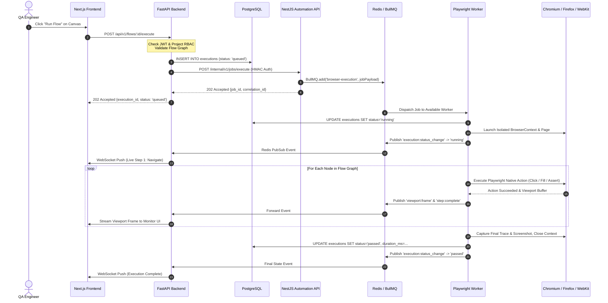

# System Architecture: Enterprise Browser Automation & Testing Platform

**Document Version:** 3.0.0  
**Status:** Approved Architectural Specification  
**Architecture Classification:** Hybrid Enterprise Automation Platform (Python + Node.js)  
**Security Classification:** Strict Zero-AI / Company Data Protection  

---

## 1. Architectural Overview

The **AutomationTestingWithAgentBrowser** platform is designed as an enterprise-grade, multi-user web application testing and browser flow automation system. It combines the strengths of **Python FastAPI** (central data orchestration, relational persistence, authentication, RBAC, and policy governance) with **Node.js NestJS & Playwright** (high-performance asynchronous browser execution, native DevTools protocol control, streaming viewport capture, and BullMQ worker concurrency).

```
                                      +---------------------------------------------+
                                      |                 Client Layer                |
                                      |    Next.js 16 (React 19, TypeScript, UI)    |
                                      | React Flow Builder, Test Suites, Live Views |
                                      +----------------------+----------------------+
                                                             |
                                           REST API & JWT    |  WebSocket Events
                                                             v
+-------------------------------------------------------------------------------------------------------------------+
|                                             Main Application Gateway                                              |
|                                            Python FastAPI Application                                             |
|                                                                                                                   |
|  * User & Organization Management      * RBAC Enforcement               * Flow & Test Definitions (CRUD)          |
|  * Environment & Secret Management     * Execution Authorization        * Audit Logging & Tamper-Evident Reports  |
|  * PostgreSQL Database Schema Owner    * Alembic Migrations             * WebSocket Live Monitor Gateway          |
+--------------------------+-------------------------------------------------------------+--------------------------+
                           |                                                             |
         Internal REST     | (HMAC Service Auth)                        Redis Pub/Sub    | Live Events
                           v                                                             v
+------------------------------------------------------+         +--------------------------------------------------+
|             Automation Service Gateway               |         |                  Redis 7.x                       |
|           Node.js NestJS Automation API              |         |  * BullMQ Job Queues (browser-execution-queue)   |
|                                                      |         |  * Live Execution Events Pub/Sub                 |
|  * Job Dispatch & Validation   * Concurrency Limits  |         |  * Distributed Lock & Idempotency Store          |
|  * Execution Status Tracking   * Graceful Cancel     |         +-----------------------+--------------------------+
+--------------------------+---------------------------+                                 |
                           |                                                             |
                           | BullMQ Enqueue                                              | BullMQ Consume
                           v                                                             v
+-------------------------------------------------------------------------------------------------------------------+
|                                         Automation Worker Fleet (BullMQ)                                          |
|                                         NestJS + Playwright Execution Node                                        |
|                                                                                                                   |
|  +--------------------+  +--------------------+  +--------------------+  +--------------------+                   |
|  |   BrowserManager   |  |   ContextManager   |  |   PageManager      |  |  LocatorResolver   |                   |
|  |  (Chromium/FF/WK)  |  | (Isolated Storage) |  | (Viewport/Network) |  | (Deterministic)    |                   |
|  +--------------------+  +--------------------+  +--------------------+  +--------------------+                   |
|  +--------------------+  +--------------------+  +--------------------+  +--------------------+                   |
|  |   ActionExecutor   |  | AssertionExecutor  |  | ArtifactCollector  |  |  ChangeDetector    |                   |
|  | (Native Playwright)|  | (Auto-waiting)     |  | (Screenshots/Trace)|  | (Similarity Matrix)|                   |
|  +--------------------+  +--------------------+  +--------------------+  +--------------------+                   |
+------------------------------------------+------------------------------------------------------------------------+
                                           |
                                           | Database Transactions & Artifact Metadata
                                           v
+-------------------------------------------------------------------------------------------------------------------+
|                                              Persistence Layer                                                    |
|                                                                                                                   |
|  * PostgreSQL 16 (Authoritative Schema & State: Users, Projects, Flows, Executions, Steps, Baselines, Audit Logs) |
|  * Persistent Artifact Volume / Object Storage (Playwright Traces, Video Recordings, Full-Page DOM Snapshots)    |
+-------------------------------------------------------------------------------------------------------------------+
```

---

## 2. Core Subsystems and Responsibilities

### 2.1 Frontend Subsystem (Next.js 16 + React 19 + TypeScript)
- **App Router & Layouts:** Public authentication routes, authenticated dashboard layout, organization/project switchers.
- **Visual Flow Builder:** React Flow canvas (`@xyflow/react`) supporting drag-and-drop nodes, validation rules, pan/zoom, undo/redo, mini-map, and live execution step highlighting.
- **Visual Test Builder & Suites:** Test case management, priority tags, precondition setups, test datasets (JSON/CSV), suite grouping, and batch run triggers.
- **Live Browser Monitor:** Canvas viewport rendering real-time screenshots and streaming events from the worker via WebSockets without exposing browser debugging ports.
- **Reporting & Artifacts:** Detailed run analysis, execution timeline charts, Playwright trace downloads, screenshots galleries, and downloadable tamper-evident reports.

### 2.2 Main Backend Subsystem (Python FastAPI)
- **Authoritative Database Owner:** Controls all PostgreSQL relational tables via SQLAlchemy 2.0 declarative models and Alembic migration scripts.
- **Authentication & RBAC:** Multi-user security supporting Super Admin, Organization Admin, Project Admin, Developer, Tester, and Viewer roles.
- **Environment & Secret Management:** AES-256-GCM encryption of environment secrets at rest; deterministic redaction in all execution logs and payloads.
- **Execution Governance:** Validates flow graph connectivity and user permissions before dispatching execution requests.
- **Internal Service Dispatcher:** Transmits authorized, validated execution jobs to the NestJS Automation Service via internal authenticated REST calls.
- **Audit & Governance:** Tamper-evident logging of all user operations and execution lifecycles with SHA-256 checksums.

### 2.3 Browser Automation Service (Node.js + NestJS + Playwright)
- **Modular NestJS Architecture:** Encapsulates browser lifecycle, execution workers, queue management, selector resolution, and change detection.
- **Playwright Native Integration:** Directly controls Chromium, Firefox, and WebKit through Playwright's native Node.js APIs without external CLI subprocess friction.
- **Browser Context Isolation:** Dedicated ephemeral browser contexts per execution run, preventing credential leaks, cookie sharing, or cross-tenant state bleed.
- **BullMQ Queue Management:** Redis-backed job lifecycle handling prioritized queues, concurrency throttles, rate limits, deterministic retries, and cancellation signals.
- **Live Event Publisher:** Emits standardized execution progress, viewport frames, and console logs into Redis Pub/Sub for immediate consumption by the monitoring gateway.
- **Deterministic Selector Resolution & Maintenance:** Implements a strict 7-layer priority resolution strategy and calculates structural/attribute similarity matrices when UI elements mutate.

---

## 3. End-to-End Execution Flow



---

## 4. Deterministic Multi-Layer Selector Strategy

The platform prohibits any AI or heuristic-based guessing. Selectors are resolved strictly according to the following deterministic priority order:

```mermaid
flowchart TD
    Start([Locate Target Element]) --> S1{1. Explicit Test ID\n`data-testid`, `data-test`}
    S1 -- Found 1 Element --> Resolved([Selector Resolved & Verified])
    S1 -- Found > 1 Elements --> Ambiguity[Ambiguity Error: Multiple matches]
    S1 -- Not Found --> S2{2. Accessible Role & Name\n`getByRole(role, {name})`}
    
    S2 -- Found 1 Element --> Resolved
    S2 -- Found > 1 Elements --> Ambiguity
    S2 -- Not Found --> S3{3. Accessible Label\n`getByLabel(text)`}
    
    S3 -- Found 1 Element --> Resolved
    S3 -- Found > 1 Elements --> Ambiguity
    S3 -- Not Found --> S4{4. Placeholder Text\n`getByPlaceholder(text)`}
    
    S4 -- Found 1 Element --> Resolved
    S4 -- Found > 1 Elements --> Ambiguity
    S4 -- Not Found --> S5{5. Exact Visible Text\n`getByText(text, {exact: true})`}
    
    S5 -- Found 1 Element --> Resolved
    S5 -- Found > 1 Elements --> Ambiguity
    S5 -- Not Found --> S6{6. Configured CSS Selector}
    
    S6 -- Found 1 Element --> Resolved
    S6 -- Found > 1 Elements --> Ambiguity
    S6 -- Not Found --> S7{7. Configured XPath Selector}
    
    S7 -- Found 1 Element --> Resolved
    S7 -- Found > 1 Elements --> Ambiguity
    S7 -- Not Found --> ChangeDetection[Trigger Deterministic Change Detection]
```

---

## 5. Dual-Engine Migration Strategy

To guarantee continuous platform availability:
1. **Coexistence Phase:** The existing Python `AgentBrowserAdapter` remains active and callable via existing endpoints.
2. **Side-by-Side Verification:** The NestJS Playwright service is deployed on port 3001 and verified using end-to-end acceptance test suites.
3. **Traffic Cutover:** FastAPI routes execution workloads to the NestJS internal API once Playwright tests achieve 100% pass rate.
4. **Decommissioning:** The Python CLI subprocess adapter is removed only after comprehensive verification.

