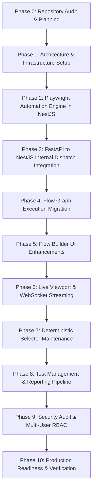

# Migration Plan: Dual-Engine Transition to NestJS & Playwright

**Document Version:** 3.0.0  
**Project:** AutomationTestingWithAgentBrowser  
**Status:** Approved Migration Plan  

---

## 1. Executive Migration Strategy

The migration transforms the system from a pure Python CLI subprocess model (`agent-browser` CLI) to a hybrid architecture featuring a high-performance **Node.js NestJS + Playwright + BullMQ** automation service, while preserving **Python FastAPI** as the central authoritative data, RBAC, and policy owner.

### Critical Migration Guardrails:
1. **Zero Downtime & Zero Regression:** Do not remove or break existing Python routes or models until the new engine has passed all acceptance tests.
2. **Deterministic & Zero-AI:** No AI libraries, no non-deterministic fuzzy heuristics.
3. **Database Single Owner:** FastAPI owns the schema and Alembic migrations; the NestJS service adheres to FastAPI's database schema contracts.
4. **Gradual Traffic Cutover:** Support a runtime engine switch (`AUTOMATION_ENGINE=playwright|agent_browser`) allowing safe rollback.

---

## 2. Phase-by-Phase Execution Roadmap

### Phase 0: Repository Audit (Completed)
- Audit entire codebase (FastAPI, Alembic, Next.js, Celery, Agent Browser CLI).
- Create core documentation (`ARCHITECTURE.md`, `TECH_STACK.md`, `SOFTWARE_REQUIREMENTS.md`, `INFRASTRUCTURE_REQUIREMENTS.md`, `API_CONTRACTS.md`, `MIGRATION_PLAN.md`, `SECURITY.md`).
- Document audit matrix and identify critical gaps.

### Phase 1: Architecture & Infrastructure Setup
- Scaffold `automation-service/` directory with NestJS 10, TypeScript 5, Playwright, and BullMQ.
- Configure Redis connection and BullMQ queue definitions.
- Update `docker-compose.yml` to include `automation-api` and `automation-worker` containers.
- Establish healthcheck endpoints.

### Phase 2: Playwright Automation Foundation
- Implement `BrowserManager` (Chromium, Firefox, WebKit lifecycle).
- Implement `BrowserContextManager` (ephemeral isolated storage, cookie boundaries).
- Implement `PageManager` (viewport, user agent, network interceptors).
- Implement `LocatorResolver` (accessible roles, labels, text, test IDs, CSS/XPath).
- Implement `ActionExecutor` (click, fill, type, select, check, scroll, upload).
- Implement `AssertionExecutor` (visible, hidden, text, URL, attribute).
- Implement `ArtifactManager` (screenshots, videos, Playwright traces).
- Write automated Playwright integration tests.

### Phase 3: Backend Integration (FastAPI <-> NestJS)
- Implement internal authenticated HTTP client in FastAPI.
- Implement `POST /internal/v1/jobs/execute` and `POST /internal/v1/jobs/:id/cancel` in NestJS.
- Wire FastAPI's `/api/v1/flows/:id/execute` to dispatch jobs to NestJS BullMQ queue.
- Maintain legacy adapter fallback via configuration flag `AUTOMATION_ENGINE`.

### Phase 4: Flow Execution Migration
- Implement TypeScript DAG traversal in NestJS `FlowExecutor`.
- Implement node configuration validation (Zod schemas).
- Implement variable interpolation (`{{VARIABLE}}`), environment variable binding, and scope resolution.
- Support branching control flow (`If/Else`, `Switch`), retries, and data extraction.

### Phase 5: Flow Builder UI Improvements
- Update Next.js React Flow canvas with 35+ node types across 7 categories.
- Enhance node property panels with role/name accessible locator builders.
- Add live step execution state indicators (pending, running, passed, failed).

### Phase 6: Live Browser Monitoring
- Playwright worker captures periodic viewport frames (`jpeg` buffer) during execution.
- Stream frames and step events to Redis channel `execution:events:{id}`.
- FastAPI WebSocket endpoint broadcasts frames to Next.js `LiveBrowserPage`.

### Phase 7: Deterministic Selector Maintenance
- Store baseline element profiles during flow execution.
- Implement deterministic structural & attribute comparison matrix upon locator failure.
- Create approval workflow UI where users review and accept candidate replacements.
- Record selector version history in `locator_history`.

### Phase 8: Test Management & Reporting
- Test suite batch execution via BullMQ workers.
- Consolidated reports with step timings, Playwright trace download, and console error logs.
- Exportable standalone HTML report generation.

### Phase 9: Security & Multi-User Governance
- Verify RBAC enforcement across all project boundaries.
- Audit SSRF prevention (RFC 1918 subnets, cloud metadata IPs).
- Enforce secret redaction in logs and artifacts.

### Phase 10: Production Readiness & Verification
- Execute full test scenarios across Chromium, Firefox, and WebKit.
- Validate Docker Compose multi-container deployment.
- Verify graceful worker shutdown and stalled job recovery.

