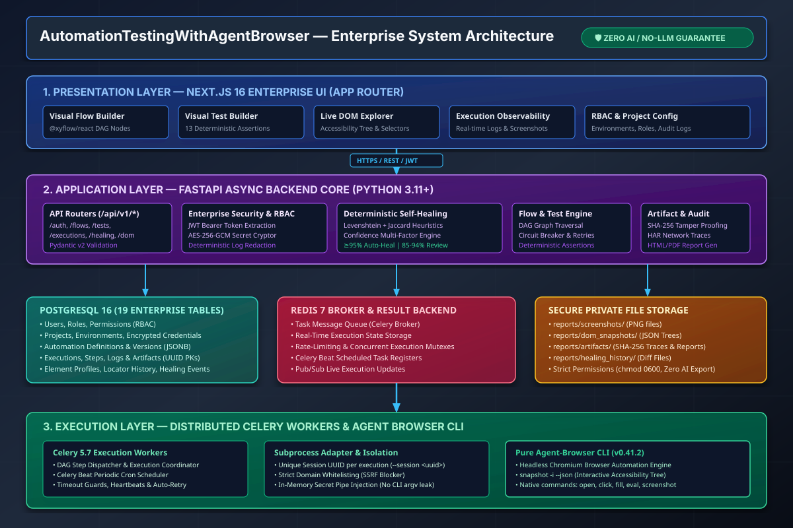
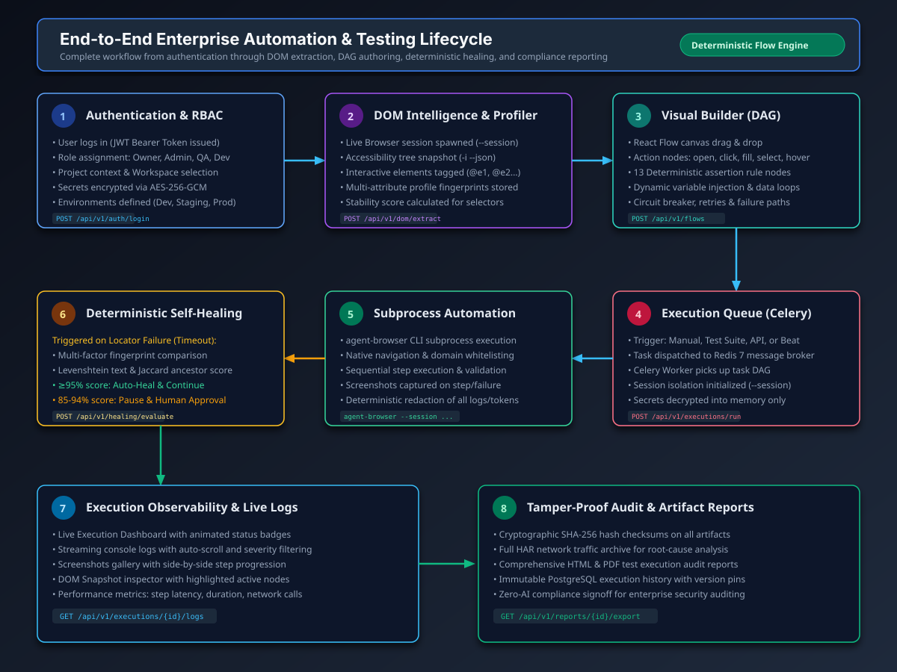
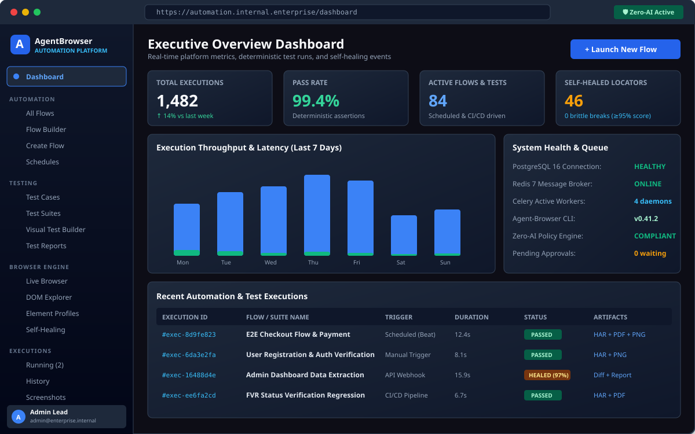
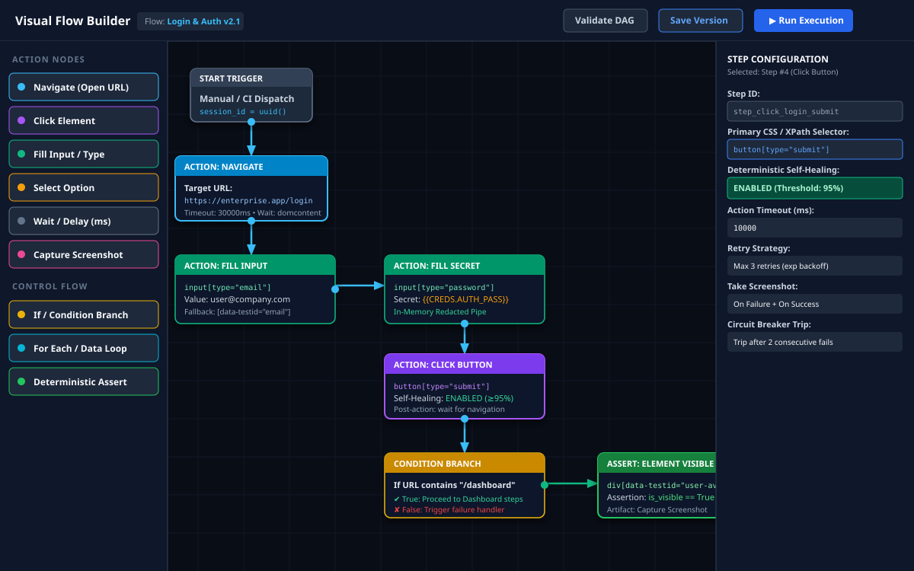
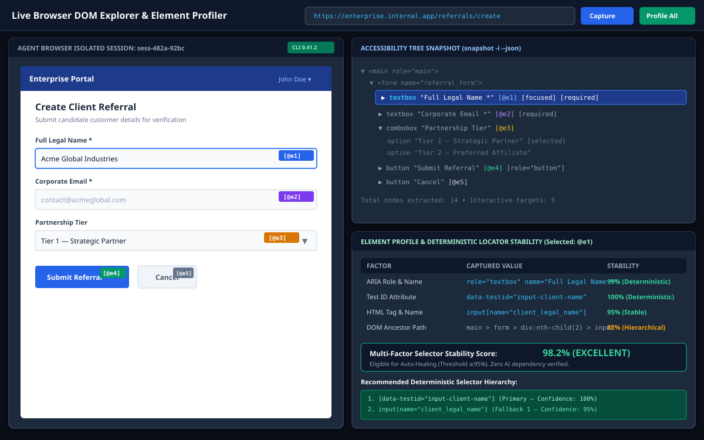
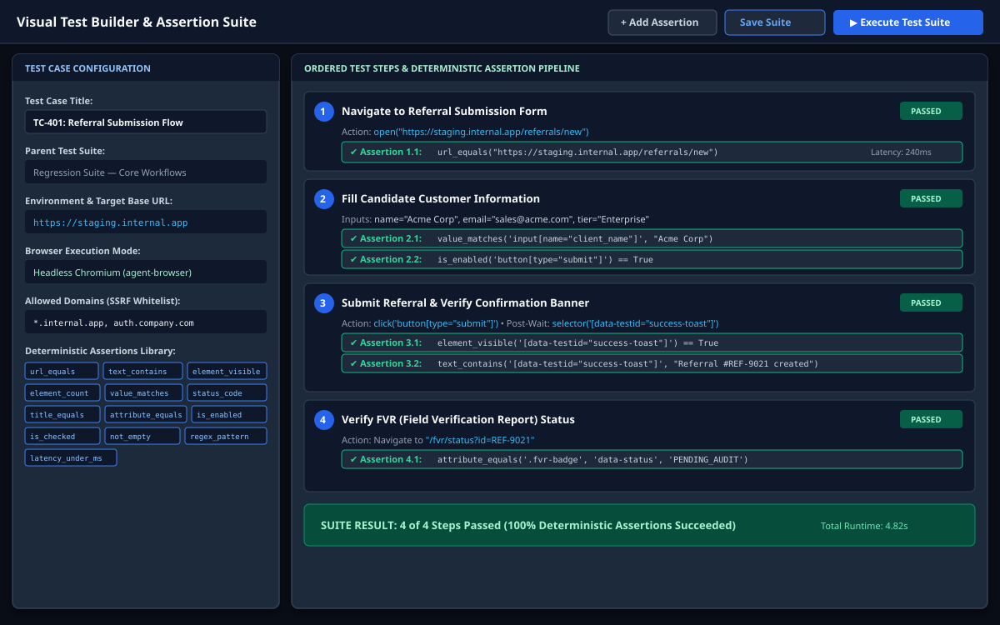
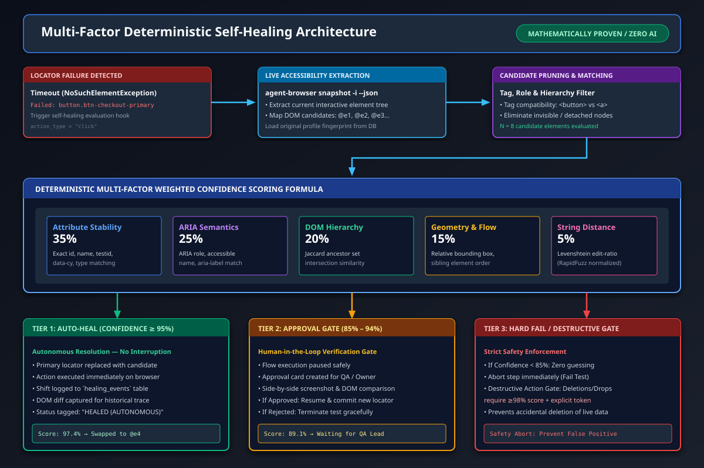
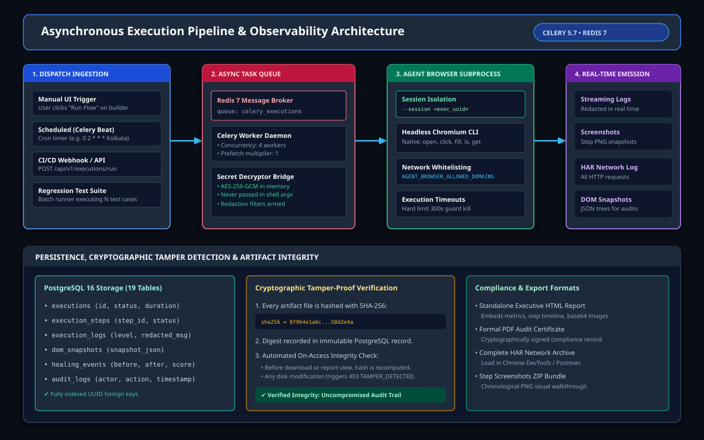
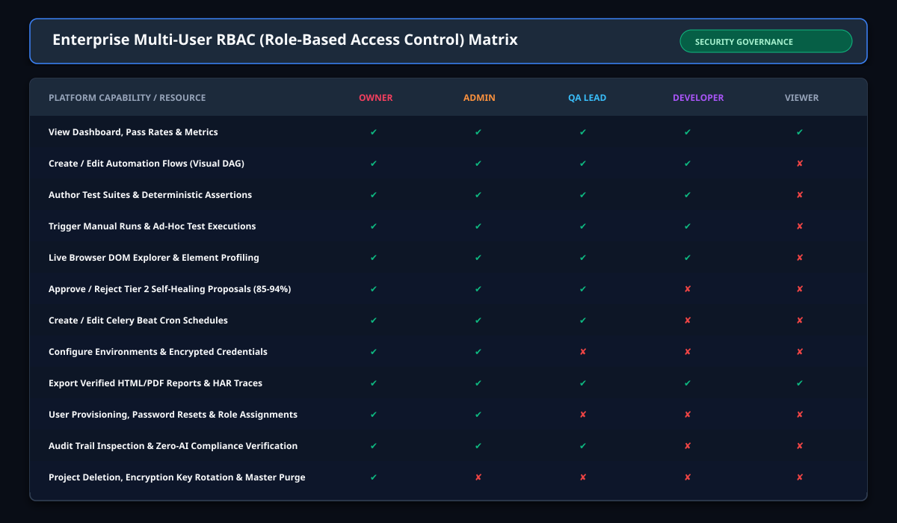
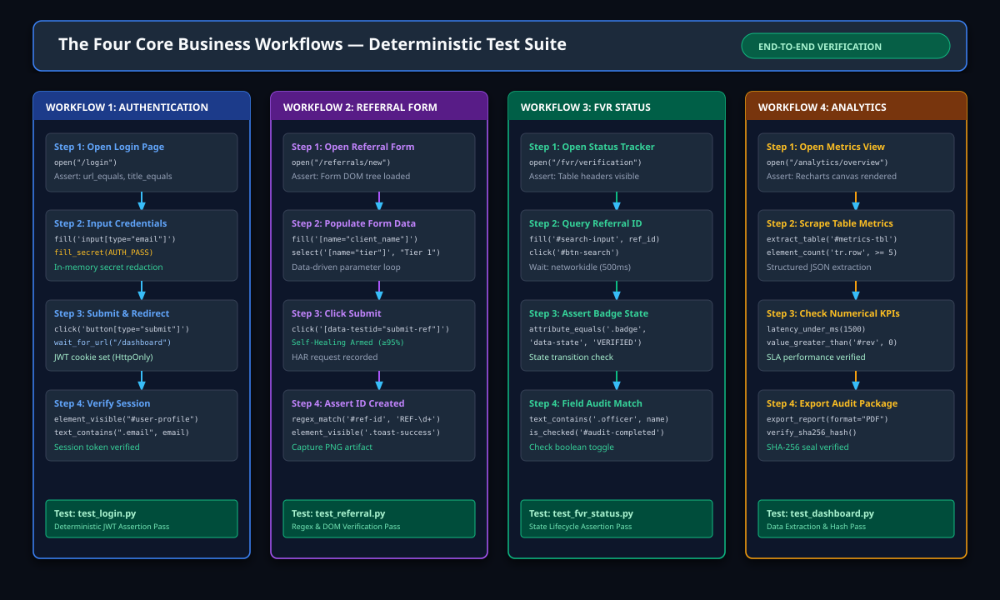

# Enterprise User Manual & Operational Guide
## AutomationTestingWithAgentBrowser
### End-to-End Visual Automation & Deterministic Testing Platform

---

> **Document Version:** 1.0.0  
> **Classification:** Internal Enterprise Documentation  
> **Compliance Standard:** Zero-AI Company Data Protection Guarantee  
> **Engine:** `agent-browser` CLI Subprocess Adapter (`v0.41.2`)  
> **Database:** PostgreSQL 16 (19 Enterprise Tables) • **Queue:** Redis 7 & Celery 5.7  

---

## 📑 Table of Contents

1. [Executive Overview & Core Principles](#1-executive-overview--core-principles)
2. [Mandatory Zero-AI Security Policy](#2-mandatory-zero-ai-security-policy)
3. [System Architecture & Infrastructure](#3-system-architecture--infrastructure)
4. [Deployment & Quick Start](#4-deployment--quick-start)
5. [End-to-End User Journey](#5-end-to-end-user-journey)
6. [Module-by-Module User Guide](#6-module-by-module-user-guide)
   - [6.1 Executive Dashboard](#61-executive-dashboard)
   - [6.2 Visual Flow Builder (DAG)](#62-visual-flow-builder-dag)
   - [6.3 Live Browser & DOM Explorer](#63-live-browser--dom-explorer)
   - [6.4 Visual Test Builder & 13 Deterministic Assertions](#64-visual-test-builder--13-deterministic-assertions)
   - [6.5 Deterministic Multi-Factor Self-Healing Engine](#65-deterministic-multi-factor-self-healing-engine)
   - [6.6 Executions Observability, Logs & Screenshots](#66-executions-observability-logs--screenshots)
   - [6.7 Configuration (Projects, Environments, Credentials)](#67-configuration-projects-environments-credentials)
   - [6.8 Administration, Users & RBAC Matrix](#68-administration-users--rbac-matrix)
7. [The Four Core Business Workflows](#7-the-four-core-business-workflows)
8. [Deterministic Self-Healing Mathematical Specification](#8-deterministic-self-healing-mathematical-specification)
9. [Cryptographic Tamper-Proof Audit & Artifacts](#9-cryptographic-tamper-proof-audit--artifacts)
10. [Troubleshooting, Health Checks & FAQ](#10-troubleshooting-health-checks--faq)

---

## 1. Executive Overview & Core Principles

**AutomationTestingWithAgentBrowser** is an enterprise-grade multi-user automation and software testing platform. It combines visual flow authoring, deterministic regression testing, live browser DOM extraction, rule-based element recognition, and mathematically proven multi-factor self-healing.

### Key Capabilities
- **Pure `agent-browser` CLI (`0.41.2`) Core:** All browser automation actions execute via isolated subprocess sessions (`--session <uuid>`), bypassing brittle WebDriver binaries.
- **Visual Node Canvas (DAG):** High-productivity workflow designer built on Next.js 16 and `@xyflow/react`.
- **Thirteen Deterministic Assertions:** Precise mathematical criteria (string equality, status codes, regex matching, element visibility, latency limits).
- **Multi-Factor Deterministic Self-Healing:** Automatic repair of broken selectors based on multi-attribute scoring, ARIA roles, ancestor hierarchies, and Levenshtein string distance—with zero probabilistic LLM inference.
- **Tamper-Evident Cryptographic Auditing:** Every screenshot, HAR network trace, and execution report is sealed with SHA-256 checksums to guarantee forensic integrity.

---

## 2. Mandatory Zero-AI Security Policy

Company data, customer records, DOM structures, user credentials, execution logs, screenshots, and test artifacts must **NEVER** be processed by, submitted to, or analyzed by artificial intelligence (AI), machine learning (ML), large language models (LLMs), or third-party AI cloud services.

```text
┌─────────────────────────────────────────────────────────────────────────────┐
│                  STRICT ZERO-AI POLICY ENFORCEMENT MATRIX                   │
├──────────────────────────────────────────┬──────────────────────────────────┤
│ PROHIBITED CAPABILITY                    │ PLATFORM DETERMINISTIC SUBSTITUTE │
├──────────────────────────────────────────┼──────────────────────────────────┤
│ OpenAI, Claude, Gemini, Cohere APIs      │ Pure Python rule-based algorithms │
│ Local LLMs (Ollama, vLLM, LM Studio)     │ Multi-factor attribute scoring    │
│ AI-generated selector guesses            │ Levenshtein edit distance (5%)    │
│ Vector embeddings & Cosine similarity    │ Jaccard ancestor set overlap(20%) │
│ AI Prompt-to-flow generators             │ Visual React Flow drag & drop DAG │
│ External telemetry beacons / AI trackers │ Private PostgreSQL 16 & local HAR │
└──────────────────────────────────────────┴──────────────────────────────────┘
```

To verify platform compliance at any time, execute the security auditor:
```bash
python scripts/verify_zero_ai_policy.py
```

---

## 3. System Architecture & Infrastructure

The platform consists of four distinct operational layers designed for high-concurrency enterprise automation:



### Layer Breakdown
1. **Presentation Layer (Next.js 16 App Router):**
   - React 19, TypeScript, Tailwind CSS, `@xyflow/react`, Recharts, and Lucide Icons.
   - Provides 7 dedicated SaaS modules: Dashboard, Flows, Testing, Browser Intelligence, Executions, Configuration, and Administration.
2. **Application Layer (FastAPI Backend Core):**
   - Python 3.11+, Pydantic v2 schemas, SQLAlchemy 2.0 ORM.
   - Versioned REST API endpoints (`/api/v1/*`), JWT bearer authentication, AES-256-GCM secret manager, and deterministic log redactor.
3. **Data, Message & File Storage Layer:**
   - **PostgreSQL 16:** 19 relational tables storing users, roles, projects, environments, automation definitions, execution steps, logs, and element profiles.
   - **Redis 7:** Celery broker and backend storing real-time execution state and rate limits.
   - **Private File Storage:** Secure directories (`./reports/screenshots`, `./reports/dom_snapshots`, `./reports/artifacts`) restricted to `chmod 0600`.
4. **Execution Layer (Celery Workers & Agent-Browser CLI):**
   - Distributed worker pool coordinating DAG step dispatch, timeouts, and retries.
   - Celery Beat scheduler executing periodic cron routines in `Asia/Kolkata`.
   - Subprocess adapter spawning isolated headless Chromium instances via `agent-browser --session <uuid>`.

---

## 4. Deployment & Quick Start

### 4.1 Prerequisites
- **Docker & Docker Compose** (Recommended for production) OR:
- **Python 3.11+** with `pip`
- **Node.js 20 LTS** with `npm`
- **Agent Browser CLI:** `npm install -g agent-browser@0.41.2`
- **PostgreSQL 16** & **Redis 7**

---

### 4.2 Production Launch (Docker Compose)
To launch all services with a single command:

```bash
docker compose up -d --build
```

**Services Initialized:**
- `frontend`: Next.js web application on `http://localhost:3000`
- `backend`: FastAPI API server on `http://localhost:8000` (Docs: `http://localhost:8000/docs`)
- `celery_worker`: Background browser execution daemon
- `celery_beat`: Periodic cron scheduler
- `postgres`: PostgreSQL 16 on port `5432`
- `redis`: Redis 7 message queue on port `6379`

---

### 4.3 Local Development Setup

#### Step 1: Clone & Configure
```bash
git clone <repository_url> AutomationTestingWithAgentBrowser
cd AutomationTestingWithAgentBrowser
cp .env.example .env
```
Ensure `.env` contains your PostgreSQL connection string, Redis URL, and `APP_ENCRYPTION_KEY`.

#### Step 2: Initialize Backend & Database
```bash
# Install Python dependencies
python -m pip install -r backend/requirements.txt

# Run database migrations
alembic upgrade head

# Start FastAPI server
uvicorn backend.main:app --host 127.0.0.1 --port 8000 --reload
```

#### Step 3: Start Celery Worker & Beat Scheduler
Open two separate terminal windows:
```bash
# Terminal 1: Celery Execution Workers
celery -A backend.app.worker.celery_app worker -l INFO -c 4

# Terminal 2: Celery Beat Periodic Scheduler
celery -A backend.app.worker.celery_app beat -l INFO
```

#### Step 4: Launch Frontend
```bash
cd frontend
npm install
npm run dev
```
Open `http://localhost:3000` in your web browser.

---

## 5. End-to-End User Journey

The diagram below maps the complete workflow from user authentication through DOM extraction, DAG flow building, asynchronous execution, self-healing, and compliance signoff:



### Complete Workflow Walkthrough

```text
[1. Authenticate & Select Project]
                │
                ▼
[2. Configure Environments & Encrypted Credentials]
                │
                ▼
[3. Live DOM Explorer — Capture Accessibility Tree (@e1, @e2)]
                │
                ▼
[4. Visual Builder — Assemble DAG Nodes & 13 Assertions]
                │
                ▼
[5. Dispatch Execution — Enqueue Task in Redis 7]
                │
                ▼
[6. Celery Worker — Spawn Isolated agent-browser Subprocess]
                │
        ┌───────┴───────┐
        ▼               ▼
 [Step Succeeded]  [Locator Timeout / Changed]
        │               │
        │               ▼
        │        [Deterministic Self-Healing Engine]
        │         ├── Multi-Factor Scoring Formula
        │         ├── Tier 1 (≥95%): Auto-Heal & Resume
        │         ├── Tier 2 (85-94%): Pause for Approval
        │         └── Tier 3 (<85%): Hard Test Failure
        │               │
        └───────┬───────┘
                ▼
[7. Observability Stream — Real-Time Logs, PNGs, HAR Traces]
                │
                ▼
[8. Audit Certificate — SHA-256 Digest & Immutable Report Export]
```

---

## 6. Module-by-Module User Guide

### 6.1 Executive Dashboard
**Route / Nav:** `dashboard_overview`

The Executive Dashboard provides operations teams, QA leads, and engineering directors with instant visibility into automation health, assertion pass rates, and self-healing statistics.



#### Key Controls & Metrics:
1. **Total Executions Card:** Real-time counter of total workflow and test runs executed.
2. **Deterministic Pass Rate:** Percentage of assertions satisfied without manual intervention.
3. **Self-Healed Locators Counter:** Number of brittle UI changes automatically repaired by Tier 1 heuristics.
4. **Throughput & Latency Chart:** 7-day rolling window of execution volume and step durations.
5. **System Health Status:** Live connectivity badges for PostgreSQL 16, Redis 7, Celery Worker pool, and Zero-AI policy compliance.
6. **Recent Executions Table:** Drill-down table linking to detailed execution logs, artifacts, and HAR traces.

---

### 6.2 Visual Flow Builder (DAG)
**Route / Nav:** `automation_builder`

The Visual Flow Builder allows users to construct complex, multi-step browser automation workflows using an interactive Directed Acyclic Graph (DAG) canvas powered by `@xyflow/react`.



#### 1. Categorized Action Catalog (30+ Deterministic Actions):
- **Browser Navigation:** `navigate`, `browser_back`, `browser_forward`, `refresh`.
- **Browser Interaction:** `click`, `double_click`, `right_click`, `hover`, `fill`, `type`, `select`, `check`, `uncheck`, `scroll`.
- **Browser Synchronization & Capture:** `wait`, `wait_until` (visibility, hidden, enabled conditions), `screenshot`.
- **DOM Extraction:** `extract_text`, `extract_attribute`, `extract_table`.
- **Logic & Control Flow:** `condition` (If/Else with true/false branch handles), `switch` (multi-case routing), `loop` (for-each array iteration), `while_loop`, `break`, `continue`.
- **Data Operations:** `set_variable`, `string_operation` (upper, lower, trim, replace, split, length), `number_operation` (add, subtract, multiply, divide, round, abs, min, max), `json_operation` (parse, stringify, get_key), `date_operation` (now, timestamp, format, add_days), `array_operation` (length, push, join, slice).
- **Governance & Control:** `approval_gate` (Tier-2 human-in-the-loop signoff), `stop` (graceful termination).

#### 2. Pre-Built Flow Templates:
**Route / Nav:** `automation_templates`
Pre-engineered reference workflows are available for one-click cloning:
- **Enterprise Login & Session Verification:** Navigates login form, injects vaulted credentials, verifies cookies, captures post-login DOM.
- **Multi-Step Form Wizard & Lead Creation:** Handles sequential tabs, required fields, dropdown selections, and form submission.
- **Dynamic Table Scraper & Validator:** Evaluates dynamic DOM tables into structured arrays and asserts data integrity.
- **FVR System Status & Health Audit:** Extracts badges, verifies operational status, and halts on alert discrepancies.

---

### 6.3 Live Browser, DOM Explorer & Browser Recorder
**Route / Nav:** `browser_live`, `browser_dom`, `browser_profiles`, `browser_recorder`

The Browser Intelligence module couples live inspection with native session recording:



#### 1. Live DOM Explorer & Element Profiler:
1. **Enter Target URL:** Input the target web application address into the top navigation bar.
2. **Click "Capture Snapshot":** The backend spawns an isolated `agent-browser` daemon and extracts the interactive accessibility tree.
3. **Reference Badges (`@e1`, `@e2`, ...):** Every interactive button, input, link, and select is tagged with an index reference.
4. **Accessibility Tree View:** Inspect semantic roles (`textbox`, `button`, `combobox`), accessible names, focus states, and required flags.
5. **Multi-Factor Element Profiler:** Click on any node to view its stability score, ARIA attributes, DOM ancestor path, and recommended deterministic selector hierarchy.

#### 2. Native Interactive Browser Recorder:
**Route / Nav:** `browser_recorder`
Record real-time user browser interactions without fragile WebDriver hooks:
- **Subprocess Session Coupling:** Uses native `agent-browser --session <uuid>` command stream.
- **Action Capture:** Intercepts navigation, clicks, text typing, select changes, and scroll actions.
- **Live Action Inspector:** Edit, reorder, or delete recorded actions before committing.
- **Dual Export:** Save recordings directly as a runnable **Automation Flow** or a formal **Test Case**.

---

### 6.4 Visual Test Builder & Test Data Management
**Route / Nav:** `testing_builder`, `testing_cases`, `testing_suites`, `testing_data`

The Visual Test Builder transforms browser workflows into verifiable, deterministic test suites:



#### 1. Test Data Management (Parameterized Datasets):
**Route / Nav:** `testing_data`
Manage data-driven test scenarios across environments without credential leakage:
- **Data Matrix Editor:** Inline tabular editing of user credentials, form inputs, and expected outcomes.
- **CSV & JSON Support:** Seamlessly import external datasets and export execution matrices.
- **Secret Masking:** One-click toggling masks passwords and API tokens with dots (`••••••••`) to prevent screen-share leakage.
- **Persistent Dataset Storage:** Datasets are saved in PostgreSQL `test_datasets` for automated binding during suite runs.

#### 2. The 13 Deterministic Assertions:
**Route / Nav:** `testing_builder`, `testing_cases`, `testing_suites`

The Visual Test Builder transforms browser workflows into verifiable, deterministic test suites. Every test case contains sequential steps coupled with explicit assertion checks.


#### The 13 Deterministic Assertions:
1. `url_equals`: Verifies current browser URL matches the expected string exactly.
2. `text_contains`: Asserts an element or page body contains the specified substring.
3. `element_visible`: Verifies the element exists in the DOM and is rendered visually (`display != none`, `opacity > 0`).
4. `element_count`: Validates the exact or range count of matching elements (e.g. `tr.row >= 5`).
5. `value_matches`: Compares input values against expected strings.
6. `status_code`: Verifies the HTTP status code of the initial navigation (e.g. `200 OK`).
7. `title_equals`: Asserts the HTML page title matches expected text.
8. `attribute_equals`: Validates HTML element attributes (e.g., `data-status == 'ACTIVE'`).
9. `is_enabled`: Asserts an input or button is active and not disabled.
10. `is_checked`: Confirms checkbox or radio button toggle state.
11. `not_empty`: Verifies that a container or input has non-whitespace content.
12. `regex_pattern`: Matches element text against a formal regex (e.g., `REF-[0-9]{4}`).
13. `latency_under_ms`: Enforces SLA response times (e.g. page transition `< 1500ms`).

---

### 6.5 Deterministic Multi-Factor Self-Healing Engine
**Route / Nav:** `browser_healing`

When web applications undergo UI updates, traditional automated tests break due to selector modifications. This platform features a mathematically proven deterministic self-healing engine:



#### Multi-Factor Scoring Formula
When a target element cannot be found, the engine extracts a fresh DOM snapshot and scores all candidate elements using a weighted formula:

$$\text{Confidence Score} = 0.35 \cdot S_{\text{attr}} + 0.25 \cdot S_{\text{aria}} + 0.20 \cdot S_{\text{hier}} + 0.15 \cdot S_{\text{geom}} + 0.05 \cdot S_{\text{str}}$$

- **Attribute Stability ($S_{\text{attr}}$, 35%):** Exact match on stable attributes (`id`, `name`, `data-testid`, `data-cy`, `type`).
- **ARIA Semantics ($S_{\text{aria}}$, 25%):** Match on accessibility role (`role="button"`) and accessible name (`aria-label`).
- **Hierarchy Overlap ($S_{\text{hier}}$, 20%):** Jaccard similarity coefficient of ancestor tags:
  $$J(A, B) = \frac{|A \cap B|}{|A \cup B|}$$
- **Geometry & Flow ($S_{\text{geom}}$, 15%):** Relative screen quadrant, bounding box dimensions, and neighbor order.
- **Normalized String Distance ($S_{\text{str}}$, 5%):** Normalized Levenshtein ratio calculated via RapidFuzz.

#### Decision Tiers:
- **Tier 1 (Confidence $\ge 95\%$):** Autonomous Auto-Heal. The engine substitutes the selector, executes the action, logs the healing event, and continues execution seamlessly.
- **Tier 2 (Confidence $85\% - 94\%$):** Human-in-the-Loop Approval Gate. Execution pauses, creating an approval request for a QA Lead or Admin to review before proceeding.
- **Destructive Action Safety Gate:** Any destructive action (deleting records, dropping tables, formatting data) requires **$\ge 98\%$ confidence** and explicit token verification.
- **Tier 3 (Confidence $< 85\%$):** Hard Failure. The engine terminates the step immediately to prevent false-positive executions.

---

### 6.6 Executions Observability, Logs & Screenshots
**Route / Nav:** `executions_running`, `executions_history`, `executions_details`, `executions_logs`, `executions_screenshots`

The execution engine provides complete visibility into every running and historical workflow:



#### Observability Features:
1. **Live Log Console:** Stream terminal output with real-time automatic redaction of passwords, tokens, and PANs.
2. **Step Progression Timeline:** Visual timeline showing status, start time, latency, and assertions for each step.
3. **Screenshots Gallery:** Chronological PNG visual walkthrough captured at every step or failure point.
4. **DOM Tree Inspector:** Side-by-side JSON snapshot comparisons illustrating exact DOM state when errors occurred.
5. **HAR Network Archive:** Full HTTP request/response traces with headers, timings, and payload inspection.

---

### 6.7 Configuration (Projects, Environments, Credentials)
**Route / Nav:** `config_projects`, `config_environments`, `config_credentials`, `config_browser`

#### 1. Projects & Multi-Tenancy
Organize automated tests into isolated enterprise workspaces. Projects maintain independent flows, suites, credentials, and audit logs.
- **Project Members:** Assign team members per project (`admin`, `editor`, `runner`, `viewer`) with granular workspace isolation (`project_members`).
- **Owner Governance:** Project creators manage member access and workspace settings.

#### 2. Environments
Define execution environments (`Development`, `Staging`, `UAT`, `Production`). Each environment specifies:
- Base URL (e.g., `https://staging.internal.app`)
- SSRF Whitelist (`AGENT_BROWSER_ALLOWED_DOMAINS`)
- Environment-specific variables (e.g., `PORT=8080`)

#### 3. Credentials & Secret Management
Store passwords, API keys, client secrets, and HTTP basic auth credentials:
- **Encryption:** AES-256-GCM authenticated cipher with 256-bit application master key.
- **Safe Injection:** Decrypted in memory only when dispatched to Celery worker; never written to disk or shell arguments.
- **Usage Syntax:** Reference credentials in builders using curly-bracket syntax: `{{CREDS.MY_SECRET_KEY}}`.

#### 4. Browser Profiles
Configure default browser viewport dimensions (e.g., `1920x1080`), default step timeouts, user agents, and download directory paths.

---

### 6.8 Administration, Users & RBAC Matrix
**Route / Nav:** `admin_users`, `admin_roles`, `admin_audit`

Enterprise governance is enforced via a Role-Based Access Control (RBAC) matrix spanning 5 standardized roles:



| Capability / Permission | Owner | Admin | QA Lead | Developer | Viewer |
| :--- | :---: | :---: | :---: | :---: | :---: |
| **View Dashboard, Pass Rates & Reports** | ✅ | ✅ | ✅ | ✅ | ✅ |
| **Create / Edit Automation Flows (DAG)** | ✅ | ✅ | ✅ | ✅ | ❌ |
| **Author Test Suites & Assertions** | ✅ | ✅ | ✅ | ✅ | ❌ |
| **Trigger Ad-Hoc / Manual Executions** | ✅ | ✅ | ✅ | ✅ | ❌ |
| **Inspect Live DOM & Profile Elements** | ✅ | ✅ | ✅ | ✅ | ❌ |
| **Approve Tier 2 Self-Healing (85–94%)** | ✅ | ✅ | ✅ | ❌ | ❌ |
| **Create / Modify Celery Beat Schedules** | ✅ | ✅ | ✅ | ❌ | ❌ |
| **Manage Environments & AES Credentials** | ✅ | ✅ | ❌ | ❌ | ❌ |
| **User Provisioning & Role Assignments** | ✅ | ✅ | ❌ | ❌ | ❌ |
| **View Forensic Audit Logs & Security** | ✅ | ✅ | ✅ | ❌ | ❌ |
| **Project Deletion & Master Key Rotation** | ✅ | ❌ | ❌ | ❌ | ❌ |

---

## 7. The Four Core Business Workflows

The platform includes verified reference implementations for four core enterprise business workflows:



### Workflow 1: Authentication & Session Verification
- **Module File:** `tests/test_login.py` / Flow: `auth_login_flow`
- **Execution Steps:**
  1. Navigate to `/login`. Assert `url_equals` and page title.
  2. Locate email input (`input[type="email"]`) and inject user email.
  3. Locate password input (`input[type="password"]`) and inject secret from AES-256 vault.
  4. Click `button[type="submit"]`. Wait for redirection to `/dashboard`.
  5. Assert HttpOnly session cookie set and `#user-profile` element visible.

### Workflow 2: Referral Creation & Validation
- **Module File:** `tests/test_referral.py` / Flow: `referral_creation_flow`
- **Execution Steps:**
  1. Navigate to `/referrals/new`.
  2. Populate client legal name, corporate email, and partnership tier combobox.
  3. Click `button[data-testid="submit-ref"]` (Self-healing enabled).
  4. Assert success notification visible: `text_contains('.toast', 'Referral created')`.
  5. Validate generated identifier format via regex: `regex_pattern('#ref-id', '^REF-[0-9]{4}$')`.

### Workflow 3: FVR (Field Verification Report) Status Verification
- **Module File:** `tests/test_fvr_status.py` / Flow: `fvr_status_verification_flow`
- **Execution Steps:**
  1. Navigate to `/fvr/verification`.
  2. Enter referral identifier into search bar and dispatch query.
  3. Assert table row rendered with expected client details.
  4. Assert verification badge attribute: `attribute_equals('.fvr-badge', 'data-state', 'VERIFIED')`.
  5. Verify audit completion checkbox state: `is_checked('#audit-completed') == True`.

### Workflow 4: Dashboard Analytics & Table Extraction
- **Module File:** `tests/test_dashboard.py` / Flow: `dashboard_analytics_flow`
- **Execution Steps:**
  1. Navigate to `/analytics/overview`.
  2. Wait for Recharts canvas and summary cards to finish rendering.
  3. Scrape table rows into structured JSON using `agent-browser eval`.
  4. Assert row count satisfies minimum SLA: `element_count('tr.data-row', '>= 5')`.
  5. Assert page response latency: `latency_under_ms(1500)`.
  6. Export PDF report and verify SHA-256 seal.

---

## 8. Deterministic Self-Healing Mathematical Specification

The self-healing algorithm runs strictly locally without external network dependencies.

### Step 1: Feature Vector Extraction
For both the baseline recorded element ($E_{\text{orig}}$) and each candidate ($E_{\text{cand}}$):

$$V = \left\langle \text{tag}, \text{role}, \text{name}, \text{testid}, \text{id}, \text{class\_set}, \text{ancestor\_tags}, \text{bbox} \right\rangle$$

### Step 2: Similarity Component Calculations
1. **Attribute Stability Match:**
   $$S_{\text{attr}} = \frac{1}{|K|} \sum_{k \in K} \mathbf{1}[E_{\text{orig}}(k) = E_{\text{cand}}(k)] \quad \text{where } K = \{\text{id}, \text{name}, \text{testid}, \text{type}\}$$
2. **ARIA Semantic Match:**
   $$S_{\text{aria}} = 0.5 \cdot \mathbf{1}[\text{role}_{\text{orig}} = \text{role}_{\text{cand}}] + 0.5 \cdot \mathbf{1}[\text{name}_{\text{orig}} = \text{name}_{\text{cand}}]$$
3. **Hierarchy Jaccard Coefficient:**
   $$S_{\text{hier}} = \frac{|\text{Ancestors}_{\text{orig}} \cap \text{Ancestors}_{\text{cand}}|}{|\text{Ancestors}_{\text{orig}} \cup \text{Ancestors}_{\text{cand}}|}$$
4. **Geometry & Position Score:**
   $$S_{\text{geom}} = 1.0 - \frac{|x_{\text{orig}} - x_{\text{cand}}| + |y_{\text{orig}} - y_{\text{cand}}|}{\text{Viewport Width} + \text{Viewport Height}}$$
5. **String Distance Ratio:**
   $$S_{\text{str}} = \text{LevenshteinRatio}(\text{text}_{\text{orig}}, \text{text}_{\text{cand}})$$

### Step 3: Composite Confidence Evaluation
$$C = 0.35 \cdot S_{\text{attr}} + 0.25 \cdot S_{\text{aria}} + 0.20 \cdot S_{\text{hier}} + 0.15 \cdot S_{\text{geom}} + 0.05 \cdot S_{\text{str}}$$

If $C \ge 0.95$, the candidate is selected autonomously. All parameters are deterministic, reproducible, and verifiable.

---

## 9. Cryptographic Tamper-Proof Audit & Artifacts

All outputs generated by the platform are cryptographically sealed to ensure enterprise audit readiness.

```text
┌─────────────────────────────────────────────────────────────────────────────┐
│                   FORENSIC ARTIFACT INTEGRITY PIPELINE                      │
├─────────────────────────────────────────────────────────────────────────────┤
│ 1. Artifact Generation (Screenshot PNG, HAR Archive, DOM Snapshot JSON)     │
│                                    │                                        │
│ 2. Compute SHA-256 Digest:         ▼                                        │
│    hash = sha256(file_bytes) ──────────────────────────┐                    │
│                                                        ▼                    │
│ 3. Atomic Database Insert:               [PostgreSQL 16 `artifacts`]        │
│    (id, execution_id, path, sha256_hash, byte_size, created_at)             │
│                                                        │                    │
│ 4. Verification on Download / Audit:                   ▼                    │
│    recomputed_hash = sha256(current_file_bytes)                             │
│    IF recomputed_hash != recorded_hash:                                     │
│        ABORT -> 403 Forbidden ("TAMPER_DETECTED_INTEGRITY_VIOLATION")      │
│    ELSE:                                                                    │
│        Serve Verified Artifact & Certificate                                │
└─────────────────────────────────────────────────────────────────────────────┘
```

---

## 10. Troubleshooting, Health Checks & FAQ

### Common Operational Questions

#### Q1: Why does self-healing pause on a 90% match?
**A:** Matches between $85\%$ and $94\%$ fall into **Tier 2 (Human-in-the-Loop Approval Gate)**. This prevents unintentional clicks on dynamically modified forms. A QA Lead or Admin must approve the proposed locator shift from the Self-Healing page.

#### Q2: How is company data protected from AI models?
**A:** The platform contains **zero AI SDKs, zero LLM endpoints, and zero outbound inference connections**. DOM snapshots and logs are processed exclusively with rule-based Python heuristics. Verify compliance anytime using `python scripts/verify_zero_ai_policy.py`.

#### Q3: Where are execution artifacts stored?
**A:** Artifacts are saved locally in the `./reports/` directory with `chmod 0600` permissions:
- Screenshots: `./reports/screenshots/`
- DOM Accessibility Trees: `./reports/dom_snapshots/`
- Trace Archives & PDFs: `./reports/artifacts/`

#### Q4: How do I change the scheduled execution timezone?
**A:** Celery Beat schedules are configured in `backend/config.py`. The enterprise default is set to `Asia/Kolkata` (`UTC+5:30`).

---

### Platform Health Check Diagnostic Command
Run the diagnostic script to verify system health across all services:

```bash
# Test API Health
curl -s http://127.0.0.1:8000/health

# Expected response:
# {"status":"ok","engine":"postgresql","platform":"AutomationTestingWithAgentBrowser"}
```

---

*AutomationTestingWithAgentBrowser — Enterprise Multi-User Automation & Testing Platform. All Rights Reserved.*

